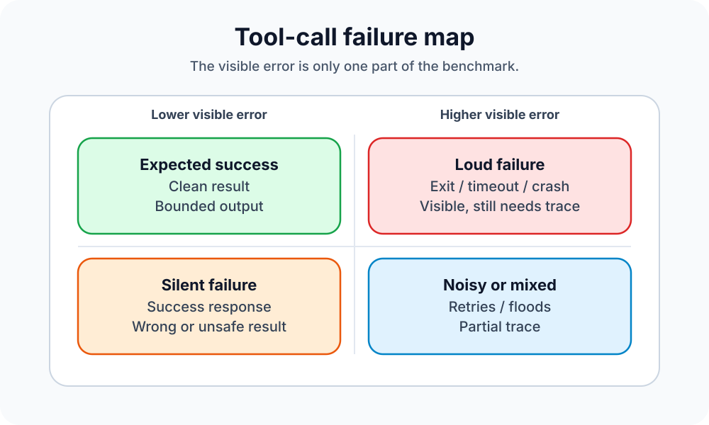
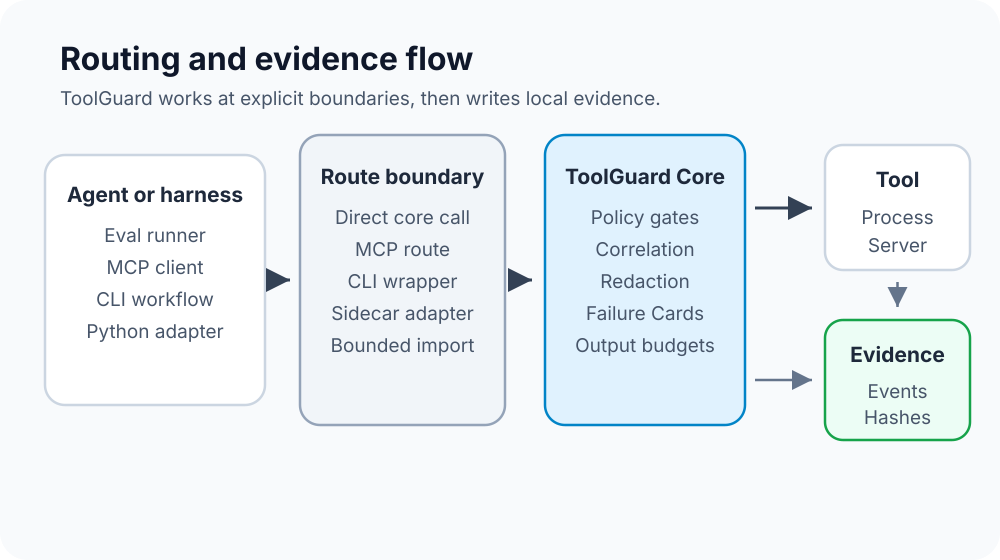
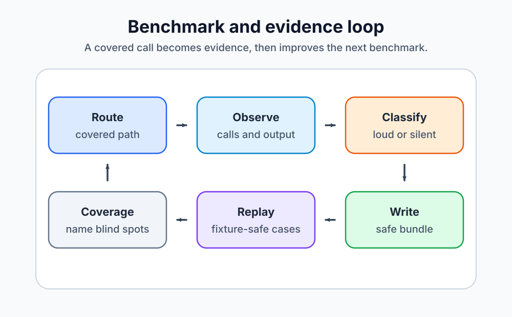

# ToolGuard

ToolGuard is a local-first benchmark and evidence layer for AI-agent tool calls, showing when tools fail loudly, fail silently, leak unsafe output, or mutate more than expected.

Toolplane is the monorepo. **ToolGuard** is the public product surface in it.

## Scope, plainly

ToolGuard records and benchmarks tool calls that are routed, wrapped, supervised, or imported through its repo surfaces:

- direct calls into `@toolplane/core`
- MCP-routed calls through `@toolplane/mcp-adapter`
- process supervision through the `toolguard` / `toolplane` CLI wrapper
- thin Python adapter calls for LangGraph and CrewAI-style flows
- bounded imported evidence, such as logs or receipts, when explicitly provided

It does **not** natively intercept arbitrary host tools that bypass ToolGuard.

## Why harnesses need this

AI-agent harnesses and eval runners often prove that an agent made a tool call, but not enough about what happened around that call.

Common problems are simple and painful:

| Harness problem               | Why it matters                                                                                      |
| ----------------------------- | --------------------------------------------------------------------------------------------------- |
| Lost correlation              | A run, tool call, retry, sidecar, artifact, and report stop lining up.                              |
| Swallowed or flattened errors | A crash, timeout, malformed JSON response, or unavailable server becomes a vague failure.           |
| Bad-success or silent failure | The tool returns success, but the output is stale, partial, wrong, unsafe, or missing side effects. |
| Context flood                 | Huge stdout or JSON is treated as normal model context instead of a bounded failure.                |
| Secret-shaped output          | Tokens, private-key-shaped text, or sensitive JSON fields can reach model-facing output.            |
| Unsafe retries                | A retry loop hides earlier failures or repeats work that should not be repeated.                    |
| No replayable evidence        | Review depends on screenshots, logs, or memory instead of a small bundle with hashes and receipts.  |

ToolGuard is meant to make those cases easier to see, compare, and reproduce for the paths that actually pass through it.

## Loud vs silent failure benchmark map

<p>
  
</p>

| Failure type | Compact definition                                                         | Examples ToolGuard can benchmark on covered paths                                                                                                                     |
| ------------ | -------------------------------------------------------------------------- | --------------------------------------------------------------------------------------------------------------------------------------------------------------------- |
| Loud         | The tool call visibly fails or is blocked.                                 | Non-zero exit, timeout, crash, malformed JSON, unavailable sidecar or server, policy block.                                                                           |
| Silent       | The tool call reports success, but the result or trace is not trustworthy. | Wrong, stale, or partial output; hidden side effects; lost correlation; missed redaction; retry loop hidden by final success; context bloat treated as normal output. |

## What ToolGuard records and benchmarks

ToolGuard focuses on evidence around the call, not on claiming the agent is smart.

It records:

- call identity and correlation fields
- attempt, retry, timeout, cancellation, and circuit-breaker events
- raw artifacts separated from safe summaries
- redaction summaries and output-budget decisions
- Failure Cards with root cause, retryability, and evidence links
- side-effect ledger rows and blast-radius summaries when the routed path provides them
- local reports, manifests, hashes, receipts, and exportable evidence bundles

It benchmarks whether covered tool paths preserve correlation, expose loud failures, catch silent bad-success cases, redact unsafe output before model-facing display, and produce evidence that can be reviewed later.

## How it works

<p>
  
</p>

ToolGuard sits at explicit boundaries. The core is protocol-independent, and adapters sit around it:

Specific repo surfaces also include explicit JS/TS wrappers, bounded HTTP/webhook imports, browser evidence summaries, Visibility JSONL imports, and local OpenTelemetry-compatible evidence exports. Each one only covers the routed, wrapped, supervised, imported, or transport evidence path named here; it does not create native interception for tools that bypass ToolGuard.

| Path                         | Coverage language                  | Notes                                                                                                    |
| ---------------------------- | ---------------------------------- | -------------------------------------------------------------------------------------------------------- |
| Direct core call             | `mediated`                         | The repo calls ToolGuard Core directly.                                                                  |
| MCP adapter                  | `mediated`                         | MCP clients route through the ToolGuard MCP proxy/router.                                                |
| CLI wrapper                  | `supervised`                       | `toolguard run -- <command>` supervises a process boundary. It cannot see host tools that run elsewhere. |
| Python adapters              | `observed` / `mediated` by sidecar | Thin adapters report calls to the local sidecar and fail closed when it is unavailable or incompatible.  |
| Imported logs or receipts    | `imported`                         | ToolGuard organizes bounded, redacted imported evidence after the fact.                                  |
| Anything bypassing ToolGuard | `not-covered`                      | No routed, wrapped, supervised, or imported boundary is present.                                         |

## Benchmark and evidence loop

<p>
  
</p>

The intended loop is small:

1. Route a tool call or deterministic fixture through a covered path.
2. Observe the call, output, retries, policy decisions, and side effects.
3. Classify loud failures, silent failures, redaction risks, and context-budget issues.
4. Write evidence locally with hashes, receipts, and safe summaries.
5. Replay or review fixture-safe cases and note what is covered or not covered.

## Quick start

Requirements from repo metadata:

| Requirement | Version                     |
| ----------- | --------------------------- |
| Node.js     | `>=22.0.0`                  |
| pnpm        | `10.25.0`                   |
| Python      | `3` for the Python adapters |

```bash
pnpm install
pnpm build
pnpm test
```

Useful root checks:

```bash
pnpm lint
pnpm typecheck
pnpm verify
```

## Demo commands

These scripts come from the root `package.json`.

```bash
# Raw deterministic fixture, without ToolGuard mediation
pnpm demo:raw-failure

# Same style of fixture through ToolGuard Core
pnpm demo:toolplane

# MCP adapter demo
pnpm demo:mcp

# Portfolio demo with local loopback Core/UI surfaces
pnpm demo

# Persistent guided story-mode demo
pnpm demo:serve
```

Demos are local-first, loopback-only where servers are involved, and fixture-driven. Core evidence paths do not require cloud credentials.

`pnpm demo:serve` uses approved loopback ports:

| Surface          | Address                           |
| ---------------- | --------------------------------- |
| Core / API / SSE | `http://127.0.0.1:3660`           |
| UI               | `http://127.0.0.1:3661`           |
| Fixture stack    | `http://127.0.0.1:3662` to `3664` |

## What evidence comes out

Typical local demo or wrapper output is written under `runs/`, which is generated evidence and should not be committed.

Evidence can include:

- `events.jsonl`
- raw stdout, stderr, and result artifacts
- safe report data and Failure Cards
- `manifest.json`
- artifact hashes
- redaction summaries
- side-effect and retry-loop summaries
- topology or narrative exports
- policy and integration receipts
- exportable evidence bundles

Raw details stay separated from model-facing summaries. User-visible reports and event payloads pass through redaction helpers first.

## Architecture and package map

```text
AI agent, eval harness, or dev workflow
        |
        | direct call | MCP route | CLI wrapper | Python adapter | import
        v
ToolGuard boundary
        |
        v
ToolGuard Core: policy, execution model, redaction, evidence, reports
        |
        v
Downstream tools, processes, fixtures, or MCP servers
```

| Package                      | Role                                                                                                             |
| ---------------------------- | ---------------------------------------------------------------------------------------------------------------- |
| `@toolplane/core`            | Protocol-independent ToolGuard runtime, event model, redaction, evidence, reports, topology, and local Core API. |
| `@toolplane/cli`             | `toolplane` and `toolguard` process wrapper CLI.                                                                 |
| `@toolplane/mcp-adapter`     | MCP proxy/router, demos, story-mode server, and integration snippets.                                            |
| `@toolplane/python-adapters` | Thin Python adapters for LangGraph and CrewAI.                                                                   |
| `@toolplane/ui`              | Vite/React local observability UI.                                                                               |

The packages are private workspace packages at version `0.0.0`. They are not published to npm or PyPI.

## Validation and status

The full local gate is:

```bash
pnpm verify
```

For faster iteration, use package-scoped commands such as:

```bash
pnpm --filter @toolplane/core test
pnpm --filter @toolplane/cli test
pnpm --filter @toolplane/mcp-adapter test
pnpm --filter @toolplane/python-adapters test
pnpm --filter @toolplane/ui test
```

Current status: local-first, demo-ready, and strongest for the checked-in deterministic demos and tests. Claims are limited to routed, wrapped, supervised, or imported paths that ToolGuard can actually see.

## Non-goals

ToolGuard does not currently claim:

- native interception of tools that bypass it
- production cloud integrations or credential-backed external services
- npm or PyPI publication
- universal visibility into every host, IDE, browser, or harness action

## License

No `LICENSE` file is present in this repository, and the package manifests do not declare a `license` field. Licensing is not specified.

<!-- dependency-credits:start -->
## Dependencies and acknowledgments

This project is built with open-source software maintained by people and communities around the world. Thank you to those maintainers and contributors. The list below covers direct package dependencies declared in this repository; lockfiles remain the source of truth for exact and transitive versions. Each dependency is governed by its own license and terms.

<details>
<summary>JavaScript / TypeScript (40)</summary>

- [`@changesets/cli`](https://www.npmjs.com/package/@changesets/cli)
- [`@eslint/js`](https://www.npmjs.com/package/@eslint/js)
- [`@modelcontextprotocol/sdk`](https://www.npmjs.com/package/@modelcontextprotocol/sdk)
- [`@sentry/node`](https://www.npmjs.com/package/@sentry/node)
- [`@sentry/react`](https://www.npmjs.com/package/@sentry/react)
- [`@size-limit/preset-app`](https://www.npmjs.com/package/@size-limit/preset-app)
- [`@tailwindcss/vite`](https://www.npmjs.com/package/@tailwindcss/vite)
- [`@tanstack/react-table`](https://www.npmjs.com/package/@tanstack/react-table)
- [`@types/jsdom`](https://www.npmjs.com/package/@types/jsdom)
- [`@types/node`](https://www.npmjs.com/package/@types/node)
- [`@types/react`](https://www.npmjs.com/package/@types/react)
- [`@types/react-dom`](https://www.npmjs.com/package/@types/react-dom)
- [`@vitejs/plugin-react`](https://www.npmjs.com/package/@vitejs/plugin-react)
- [`@vitest/coverage-v8`](https://www.npmjs.com/package/@vitest/coverage-v8)
- [`clinic`](https://www.npmjs.com/package/clinic)
- [`depcheck`](https://www.npmjs.com/package/depcheck)
- [`dependency-cruiser`](https://www.npmjs.com/package/dependency-cruiser)
- [`eslint`](https://www.npmjs.com/package/eslint)
- [`eslint-plugin-import`](https://www.npmjs.com/package/eslint-plugin-import)
- [`eslint-plugin-react-hooks`](https://www.npmjs.com/package/eslint-plugin-react-hooks)
- [`eslint-plugin-react-refresh`](https://www.npmjs.com/package/eslint-plugin-react-refresh)
- [`husky`](https://www.npmjs.com/package/husky)
- [`jscpd`](https://www.npmjs.com/package/jscpd)
- [`jsdom`](https://www.npmjs.com/package/jsdom)
- [`knip`](https://www.npmjs.com/package/knip)
- [`lint-staged`](https://www.npmjs.com/package/lint-staged)
- [`posthog-js`](https://www.npmjs.com/package/posthog-js)
- [`prettier`](https://www.npmjs.com/package/prettier)
- [`prom-client`](https://www.npmjs.com/package/prom-client)
- [`react`](https://www.npmjs.com/package/react)
- [`react-dom`](https://www.npmjs.com/package/react-dom)
- [`size-limit`](https://www.npmjs.com/package/size-limit)
- [`syncpack`](https://www.npmjs.com/package/syncpack)
- [`tailwindcss`](https://www.npmjs.com/package/tailwindcss)
- [`typedoc`](https://www.npmjs.com/package/typedoc)
- [`typescript`](https://www.npmjs.com/package/typescript)
- [`typescript-eslint`](https://www.npmjs.com/package/typescript-eslint)
- [`vite`](https://www.npmjs.com/package/vite)
- [`vitest`](https://www.npmjs.com/package/vitest)
- [`zod`](https://www.npmjs.com/package/zod)

</details>

<details>
<summary>Python (12)</summary>

- [`black`](https://pypi.org/project/black)
- [`coverage`](https://pypi.org/project/coverage)
- [`crewai`](https://pypi.org/project/crewai)
- [`deptry`](https://pypi.org/project/deptry)
- [`langgraph`](https://pypi.org/project/langgraph)
- [`mypy`](https://pypi.org/project/mypy)
- [`prometheus-client`](https://pypi.org/project/prometheus-client)
- [`pytest-xdist`](https://pypi.org/project/pytest-xdist)
- [`radon`](https://pypi.org/project/radon)
- [`ruff`](https://pypi.org/project/ruff)
- [`sentry-sdk`](https://pypi.org/project/sentry-sdk)
- [`vulture`](https://pypi.org/project/vulture)

</details>

<details>
<summary>Dependency declaration files (7)</summary>

- [`package.json`](package.json)
- [`packages/cli/package.json`](packages/cli/package.json)
- [`packages/core/package.json`](packages/core/package.json)
- [`packages/mcp-adapter/package.json`](packages/mcp-adapter/package.json)
- [`packages/python-adapters/package.json`](packages/python-adapters/package.json)
- [`packages/python-adapters/pyproject.toml`](packages/python-adapters/pyproject.toml)
- [`packages/ui/package.json`](packages/ui/package.json)

</details>

If you redistribute this project, review the linked manifests, lockfiles, and dependency licenses for any attribution or notice requirements.
<!-- dependency-credits:end -->
